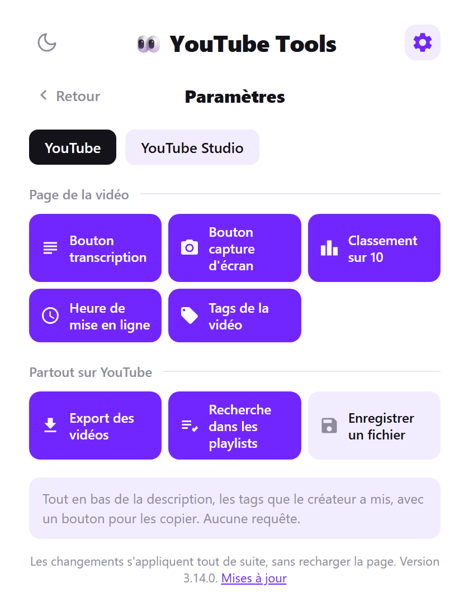

<div align="center">


# YouTube Tools

Teste ta miniature, copie une transcription, exporte un feed, situe une vidéo dans sa chaîne, lis mieux YouTube Studio — **sans jamais quitter YouTube**.

[**⬇ Télécharger l'extension**](https://github.com/ConejoCORP/youtube-tools/releases/latest/download/youtube-tools.zip) · [Releases](https://github.com/ConejoCORP/youtube-tools/releases)

Chrome · Edge · Brave · Opera


</div>

> **Reprise de PrevYou.** Cette extension part de **PrevYou** de BenjaminCode (design BastiUi), **parce que la version publiée ne fonctionne plus** : Chrome a désactivé les extensions Manifest V2, et YouTube a renommé les classes CSS que l'ancien code ciblait. Tout a été recodé de zéro en MV3.

## Ce que ça fait

YouTube montre une foule de choses qu'il ne laisse pas récupérer : l'effet réel d'une miniature au milieu des autres, le texte d'une vidéo, les chiffres d'un feed, la place d'une vidéo dans l'historique de sa chaîne. Il faut tout relever à la main, ou renoncer.

YouTube Tools ajoute ses outils directement dans l'interface. Chacun sort une information que tu voyais déjà, dans une forme exploitable : du **CSV** prêt à coller dans un tableur ou un agent IA, et un aperçu de miniature posé **dans le vrai feed**, au milieu des vraies vidéos.

## Pourquoi pas juste ouvrir la miniature en grand ?

Parce que ce n'est jamais comme ça qu'elle sera vue. Ce qui compte, c'est la lisibilité du texte une fois réduit, le contraste face aux miniatures voisines, et la longueur du titre avant que YouTube ne le coupe. Aucun de ces trois points ne se voit hors du feed.

## Fonctionnalités

- 🖼️ **Aperçu de miniature dans le vrai feed** — accueil, abonnements, recherche, page de chaîne, suggestions du lecteur. Une vraie carte est clonée, donc le rendu suit toujours le layout courant de YouTube
- 🎲 **Position aléatoire** — place ta carte quelque part dans la grille plutôt qu'en tête, là où la comparaison est honnête
- 📝 **Transcription en CSV** — un bouton à côté du J'aime, timecodes et métadonnées de la vidéo inclus
- ✨ **Résumé de la vidéo par Gemini** — côte à côte avec la vidéo, timecodes cliquables, point en cours surligné
- 💬 **Résumé des commentaires** — une centaine chargés automatiquement, ressenti, tendances, critiques et demandes
- 📸 **Capture d'écran de la vidéo** — un bouton dans le lecteur, image à la résolution réelle, copiée en un clic
- 💾 **Export des vidéos d'une page** — depuis la barre du haut, sur toutes les pages YouTube
- 🏆 **Classement sur 10** — où se situe la vidéo parmi les 10 dernières de sa chaîne, à âge égal
- 🕒 **Heure exacte de mise en ligne** — sous la vidéo, juste après la date
- 🔎 **Recherche dans une playlist** — un champ en haut de la playlist, qui fouille aussi les vidéos pas encore chargées
- 🎬 **Outils YouTube Studio** — classement Vidéos / Shorts séparés, flèches de tendance à côté des vues, zoom dans la rétention, revenus masqués, heure exacte au survol, vidéo similaire de plusieurs Shorts d'un coup
- 🌗 **Thème clair / sombre** — les boutons mesurent le fond de la page et s'y accordent, sans recharger
- ⚙️ **Paramètres** — chaque outil s'active ou se coupe depuis le popup
- 🔒 **Aperçu ponctuel** — rien ne s'affiche tant que tu n'as pas cliqué, et tout disparaît dès que tu navigues

## Prise en main

1. [**Télécharge `youtube-tools.zip`**](https://github.com/ConejoCORP/youtube-tools/releases/latest/download/youtube-tools.zip) et décompresse-le **là où il restera** (pas dans Téléchargements, qu'on vide un jour ou l'autre) : par exemple `Documents\youtube-tools`.
2. Ouvre `chrome://extensions` et active le **Mode développeur** en haut à droite.
3. **Charger l'extension non empaquetée** → sélectionne le dossier `youtube-tools` obtenu.
4. Une page **Bienvenue** s'ouvre : clique **Choisir le dossier** et désigne ce même dossier `youtube-tools`. C'est le moment, tu sais encore où il est.
5. Épingle l'extension dans la barre d'outils.

Ensuite, plus besoin de retélécharger ni de chercher le dossier : quand une nouvelle version sort, une pastille **MAJ** apparaît sur l'icône et le popup propose **Mettre à jour**. L'extension s'installe dans le dossier mémorisé.

*(Sur Edge, Brave ou Opera : `edge://extensions`, `brave://extensions`, etc. — la marche à suivre est identique. **Brave** bloque par défaut l'accès aux dossiers dont la mise à jour automatique a besoin : la page Bienvenue explique comment l'activer, une fois pour toutes, dans `brave://flags/#file-system-access-api`.)*

Pour l'aperçu de miniature : clique sur l'icône, renseigne la chaîne, glisse ou colle ta miniature, saisis le titre, puis **Aperçu**. L'onglet YouTube passe au premier plan avec ta carte injectée. **Retirer l'aperçu** l'enlève ; la flèche circulaire remet les champs à zéro.

## Les outils

### Aperçu de miniature

Volontairement **éphémère** : la carte n'apparaît qu'au clic, uniquement sur la page où tu as cliqué, et disparaît dès que tu navigues ou recharges. Tant que tu ne cliques pas, l'extension ne touche à rien.

### Transcription (bouton ☰, à côté du J'aime)

Copie toute la transcription dans le presse-papiers, métadonnées de la vidéo comprises :

```csv
titre,chaine,debut,fin,debut_s,texte,date,date_iso,vues,vues_num,likes,multiplicateur,multiplicateur_source,duree,duree_s,url,id
"Ma vidéo","Ma Chaîne","0:00","0:05","0","Première phrase","il y a 3 semaines","2026-08-16","1 659 225 vues","1659225","21816","1.6x","vidIQ","1:00:44","3644","https://…","lZGoJT4abos"
```

`date_iso` est **toujours** une date absolue : une date relative pourrit, « il y a 9 mois » désignera autre chose dans trois mois. `vues_num` et `likes` reprennent les comptes exacts quand la page les donne. `duree_s` permet de trier et de calculer des densités.

`multiplicateur` dit combien de fois mieux (ou moins bien) que d'habitude la vidéo marche pour sa chaîne. `multiplicateur_source` dit d'où il vient :

- `vidIQ` : celui que **vidIQ** affiche sous « Outlier », si l'extension est installée et que son panneau est chargé ;
- `calculé` : sinon, l'extension le calcule elle-même. Ce sont les vues de la vidéo divisées par la **médiane** de ses 9 précédentes, ramenées **au même âge**. Le calcul utilise la même liste que le classement sur 10, donc aucune requête de plus quand le panneau du classement l'a déjà chargée. Les valeurs sont proches de celles de vidIQ, sans être identiques : 0.9x contre 1.2x, 1.2x contre 1.6x, 2.2x contre 1.8x sur trois vidéos testées ;
- vide : ni l'un ni l'autre, par exemple un direct en cours, ou le réglage **Classement sur 10** coupé, puisque c'est lui qui autorise les requêtes vers YouTube.

### Résumé par Gemini (bouton ✨ Résumer, à côté du ☰)

Une fois la transcription copiée, un bouton **Résumer** apparaît à côté. Il envoie la transcription à **Gemini**, puis affiche le résumé **en haut de la colonne de droite**, à lire en même temps que la vidéo :

- **En bref** en une phrase, puis un **Déroulé** : une ligne courte et horodatée par moment, environ une toutes les 90 s, pour voir d'un coup d'œil de quoi parle chaque passage ;
- **À retenir** : deux ou trois idées clés, chacune avec le moment où elle est dite ;
- chaque **timecode est cliquable** et amène la vidéo au bon moment ;
- le point en cours de lecture est **surligné** au fil de la vidéo ;
- le temps de la lecture, le **classement sur 10 et le panneau de vidIQ s'effacent** pour que le résumé soit côte à côte avec la vidéo — sur cette vidéo seulement : les suivantes les retrouvent, et fermer le résumé les rend aussi.

Si Gemini oublie un timecode, l'extension retrouve le passage correspondant dans la transcription, sans nouvelle requête. Un timecode ainsi déduit s'affiche **encadré** plutôt que plein, pour qu'on sache que c'est une estimation.

Aucune clé d'API : c'est ta session Gemini qui répond. Une petite fenêtre Gemini s'ouvre le temps de la rédaction puis se referme toute seule — elle doit rester au premier plan, Gemini ne rédige pas dans un onglet caché. Il faut être connecté à [gemini.google.com](https://gemini.google.com) dans ce navigateur, et chaque résumé crée une conversation dans ton historique Gemini. Rouvrir le résumé d'une vidéo ne redemande rien.

### Résumé des commentaires (bouton dans l'en-tête des commentaires)

À côté de **Trier par**, un bouton **Résumer les commentaires**. YouTube n'en affiche qu'une vingtaine à la fois : l'extension fait défiler la page pour en charger une **centaine**, revient exactement où tu étais, puis les envoie à Gemini en **une seule demande**. Le résumé s'affiche juste sous l'en-tête :

- **En bref** — le ressenti général, en une phrase ;
- **La majorité** et **Une minorité** — ce que pensent la plupart des gens, et les avis moins répandus ;
- **Ce que les gens demandent** — une suite, un sujet, une précision.

Des points globaux et courts, pas de citations : ça se lit en dix secondes.

Les likes et le nombre de réponses accompagnent chaque commentaire : un avis très aimé pèse plus qu'un autre. Les timecodes cités par le public deviennent cliquables.

### Export des vidéos d'une page (bouton ⤓, barre du haut)

Copie toutes les vidéos **actuellement chargées** — rien n'est préchargé, donc déroule autant que tu veux avant de cliquer :

```csv
position,titre,chaine,vues,vues_num,date,duree,duree_s,multiplicateur,type,url
"1","KEYBOARD ESCAPE…","Kevko Gaming","149 k vues","149000","il y a 16 heures","18:48","1128","1.4x","video","https://…"
```

`position` donne le rang sur la page. `multiplicateur` reprend le `1.4x` de **vidIQ** si l'extension est installée. `type` vaut `video`, `short` ou `playlist`.

### Capture d'écran (bouton 📷, dans le lecteur)

Un appareil photo dans la barre du lecteur, à gauche des sous-titres. Un clic prend l'image affichée **à la résolution de la vidéo** (1920×1080 pour une vidéo en 1080p, quelle que soit la taille de la fenêtre) et la copie dans le presse-papiers, prête à coller. Avec **Enregistrer un fichier**, un `.png` est aussi téléchargé, nommé d'après le titre et l'instant (`ma-video_12m05s.png`). Marche en plein écran. Aucune requête.

### Classement sur 10 (panneau, colonne de droite)

Place de la vidéo parmi les 10 dernières de sa chaîne, **à âge égal** : les plus anciennes ayant eu plus de temps, on estime combien de vues chacune avait au même âge. Reprise de la fonction du même nom de **Better YouTube Studio** (SQUIDUU), avec le même modèle de calcul.

<div align="center">

</div>

C'est la **seule** fonction de la page de lecture qui interroge YouTube — la liste des vidéos d'une chaîne n'est pas dans la page. Elle le fait **sans aucun cookie**, uniquement sur des données publiques, avec un cache de 6 h, et l'interrupteur du popup la coupe entièrement.

### Heure exacte de mise en ligne

YouTube écrit la date d'une vidéo, jamais l'heure. Description ouverte, l'extension l'ajoute juste après : « 13 juin 2026 **à 13:00** », à l'heure de ton ordinateur. L'heure est déjà dans les données de la page : **aucune requête**.

### Recherche dans une playlist

Un champ en haut de chaque playlist filtre les vidéos par **titre** ou par **chaîne**, sans tenir compte des accents ni des majuscules (« noel » trouve « Noël »). YouTube ne charge une playlist que par lots de 100 : pendant une recherche, l'extension lui fait charger la suite, comme si tu défilais jusqu'en bas (une requête de YouTube par lot de 100 vidéos, aucune de l'extension). Échap vide le champ.

### Dans YouTube Studio

Six ajouts, inspirés de **Better YouTube Studio** (SQUIDUU). Cinq ne lisent jamais ta session Google : tout part des chiffres affichés, des données déjà chargées par Studio ou des données publiques de la chaîne. Le sixième, la vidéo similaire en lot, est le seul qui modifie ta chaîne, donc le seul qui passe par ta session (détails plus bas).

- **Classement sur 10, Vidéos / Shorts séparés** — sur le tableau de bord, la carte *Performances de la dernière vidéo* gagne deux onglets. Chacun classe ton dernier contenu de ce format parmi les 10 derniers **du même format**, à âge égal : une vidéo n'est plus comparée à des Shorts. Même calcul que le classement de la page de lecture (données publiques, sans cookie), donc des estimations proches de celles de Studio, pas identiques.
- **Flèches de tendance** — page *Contenu*, à côté des vues de chaque vidéo publique : ▲ vert si elle fait mieux que les trois quarts des 10 vidéos précédentes **au même âge**, ▼ rouge si elle fait moins bien, — gris dans la normale. Le survol donne la fourchette habituelle. Calculé uniquement avec les dates et les vues affichées dans la liste : **aucune requête**.
- **Zoom dans le graphique de rétention** — le graphique reste à sa place, c'est la courbe qui zoome : **molette** vers le haut à l'endroit voulu, vers le bas pour dézoomer, **glisser** (ou Maj + molette) pour se déplacer, **double-clic** pour revenir. L'échelle des % s'adapte à la portion visible, les points de mesure apparaissent, le survol donne l'instant et le pourcentage, et la vue suit la lecture du lecteur de la carte.
- **Masquer les revenus** — chaque montant de Studio est flouté ; un clic dessus l'affiche. Pour filmer ou partager ton écran. Un titre qui cite un prix n'est jamais flouté : seul un texte qui *est* un montant l'est.
- **Heure exacte au survol** — page *Contenu*, survole une date : « Publiée le samedi 3 janvier 2026 à 10:54:29 » (ou l'heure d'import pour une vidéo pas encore publiée). Studio a déjà chargé cette heure avec la liste : **aucune requête**.
- **Vidéo similaire de plusieurs Shorts** — *Contenu > Shorts* : coche des Shorts, puis **Modifier > Vidéo similaire**. Choisis la vidéo dans le sélecteur de Studio (ou **Retirer la vidéo similaire**), clique **Appliquer**, relis la confirmation qui liste les Shorts, et confirme. Chaque Short est mis à jour l'un après l'autre, avec un ✓ ou la raison d'un échec. Seuls les Shorts cochés **sur la page affichée** sont modifiés.

#### La vidéo similaire en lot et ta session

Changer la vidéo similaire d'un Short, c'est modifier ta chaîne : Studio exige ta session pour ça, comme quand tu le fais à la main. Pour cette fonction, et seulement sur l'onglet *Contenu > Shorts* :

- l'extension garde **en mémoire, dans la page**, le « contexte » que Studio joint à ses propres requêtes (il contient un jeton de session) ;
- **rien n'est envoyé avant que tu confirmes**. Ensuite, pour chaque Short, elle envoie à `studio.youtube.com` la même demande que Studio, signée comme Studio la signe (à partir du cookie de session, lu à ce moment-là) ;
- rien n'est enregistré, rien ne part ailleurs que chez Studio, et la case **Vidéo similaire en lot** des paramètres coupe tout.

C'est aussi la méthode de Better YouTube Studio.

## Paramètres

La **roue crantée** en haut du popup ouvre l'écran des paramètres : une **case cliquable** par réglage, pleine quand il est actif, rangées par site (onglets **YouTube** et **YouTube Studio**) puis par section. Survoler une case explique ce qu'elle fait. Ouvert depuis Studio, l'écran montre directement l'onglet Studio.

| Site | Case | Effet |
|---|---|---|
| YouTube | **Bouton transcription** | affiche ou retire le **☰** à côté du J'aime |
| YouTube | **Bouton capture d'écran** | affiche ou retire le **📷** du lecteur |
| YouTube | **Classement sur 10** | affiche le panneau de la page de lecture — et coupe ses requêtes, ainsi que le multiplicateur calculé de la transcription |
| YouTube | **Heure de mise en ligne** | ajoute ou retire l'heure après la date, sous la vidéo |
| YouTube | **Export des vidéos** | affiche ou retire le **⤓** en haut de page |
| YouTube | **Recherche dans les playlists** | affiche ou retire le champ de recherche des playlists |
| YouTube | **Enregistrer un fichier** | télécharge un fichier **en plus** de la copie : `.csv` pour les exports, `.png` pour une capture |
| Studio | **Masquer les revenus** | floute les montants (désactivé par défaut) |
| Studio | **Onglets Vidéos / Shorts** | le classement séparé du tableau de bord — et coupe ses requêtes |
| Studio | **Zoom sur la rétention** | active ou coupe le zoom à la molette |
| Studio | **Flèches de tendance des vues** | affiche ou retire les flèches de la page *Contenu* |
| Studio | **Heure exacte au survol** | affiche ou non l'heure au survol d'une date, page *Contenu* |
| Studio | **Vidéo similaire en lot** | ajoute ou retire « Vidéo similaire » du menu *Modifier* des Shorts — et coupe tout accès à la session |

Les changements s'appliquent **immédiatement**, sans recharger l'onglet.

<div align="center">

</div>

## Vie privée

Les images sont redimensionnées puis gardées dans `chrome.storage.local`, sur ta machine. L'extension n'a **aucun serveur** à elle. Trois fonctions sortent du navigateur, et seulement quand tu les utilises :

- les **résumés** envoient la transcription ou les commentaires à **Gemini**, dans ta propre session Google ;
- le **classement sur 10** lit la liste publique des vidéos de la chaîne, sans cookie — dans Studio aussi ;
- la **vidéo similaire en lot** envoie, après ta confirmation, une demande par Short à Studio, avec ta session Studio (voir [plus haut](#la-vidéo-similaire-en-lot-et-ta-session)).

Dans **YouTube Studio**, l'extension lit et modifie l'affichage des pages (c'est l'accès à `studio.youtube.com` que demande Chrome). En dehors de la vidéo similaire en lot, elle ne lit **ni cookie ni session** : flèches, zoom, heure au survol et revenus masqués ne font aucune requête.

La **mise à jour automatique** lit `version.json` sur GitHub, sans cookie. Elle ne contacte jamais YouTube.

## Mise à jour automatique

Au démarrage du navigateur et à chaque ouverture du popup, l'extension lit [`version.json`](version.json) sur GitHub. Si une version plus récente existe :

1. une pastille **MAJ** s'affiche sur l'icône, et un bandeau **Version x disponible** en haut du popup ;
2. **Mettre à jour** ouvre une page dédiée, qui montre les nouveautés ;
3. **Mettre à jour maintenant** télécharge tous les fichiers, les écrit dans le dossier de l'extension, puis la recharge. Rafraîchis ensuite tes onglets YouTube (F5).

Aucune API ne permet à une extension de réécrire ses propres fichiers : on passe par l'accès aux fichiers du navigateur. Il faut donc lui montrer **une fois** le dossier `youtube-tools` (celui qui contient `manifest.json`) : dès l'installation, sur la page **Bienvenue**, ou à la première mise à jour si tu l'as passée. Il est ensuite mémorisé ; la page de mise à jour dit lequel et permet d'en choisir un autre. Chrome peut encore te demander de **confirmer l'accès** d'un clic (s'il propose **Autoriser à chaque visite**, choisis-le) : il ne laisse aucune extension modifier des fichiers sans que tu l'aies vu.

La page de mise à jour s'ouvre aussi depuis le popup, **Paramètres → Mises à jour**.

Sur **Brave**, l'accès aux dossiers est coupé par défaut : ouvre `brave://flags/#file-system-access-api`, mets **File System Access API** sur **Enabled** et relance Brave. Sans ça, la page le détecte et l'explique, et les mises à jour restent possibles à la main.

Tu as oublié où est le dossier ? Le lien **Voir son emplacement** de la page de mise à jour ouvre la fiche de l'extension dans `chrome://extensions` : le chemin complet y est écrit, à « Chargée depuis ».

Garde-fous : tout est téléchargé **avant** d'écrire quoi que ce soit (une coupure réseau ne laisse pas l'extension à moitié à jour), seuls les fichiers qui ont **changé** sont réécrits, le dossier choisi doit bien être celui de YouTube Tools, et la seule adresse contactée est `raw.githubusercontent.com`, sans cookie. Si un fichier ne peut pas être écrit (un antivirus qui le bloque, par exemple), les autres le sont quand même, la page dit lequel, et la nouvelle version n'est pas annoncée tant que tout n'est pas en place. Ça ne concerne que l'installation « non empaquetée » décrite plus haut. Mécanisme repris de [youtube-ad-tool](https://github.com/Slipers/youtube-ad-tool).

## Lancer les tests

```bash
cd tests && npm install && node run.js
```

Tous les outils, sur des pages YouTube et Studio simulées (jsdom) : **aucune requête réseau**. Les tests qui ont besoin d'une vraie page de lecture enregistrée la cherchent dans `Téléchargements/HTML DE LA PAGE.txt` (ou dans la variable `YTTOOLS_DUMP`) et sont ignorés sans elle — voir [`tests/_outils.js`](tests/_outils.js).

```bash
node youtube-tools/tests/rank-core.test.js
```

Le cœur du classement, contre de vraies chaînes publiques. Environ 11 requêtes, sans cookie.

## Publier une nouvelle version (pour les mainteneurs)

```bash
node release.js "Ce qui change"
```

Le script lit le numéro de version dans `youtube-tools/manifest.json` — seule source de vérité —, écrit et pousse `version.json` (la version, le commit publié et la liste de ses fichiers, que lit la mise à jour automatique), fabrique l'archive, crée le tag et publie la release. L'archive porte toujours le même nom, donc le lien de téléchargement du README ne change jamais. Nécessite [GitHub CLI](https://cli.github.com/) authentifié, et un dépôt propre et poussé.

## Sous le capot

Comment l'extension survit aux refontes de YouTube, pourquoi elle lit les métadonnées par ce qu'elles *disent* plutôt que par leur nom de classe, comment elle cohabite avec vidIQ et Better YouTube Studio : voir **[NOTES-TECHNIQUES.md](NOTES-TECHNIQUES.md)**.

## Structure

```
youtube-tools/
├── manifest.json    MV3 — storage, scripting, activeTab, clipboardWrite
├── popup.html/css/js   interface (thème, drag & drop, paramètres)
├── common.js        réglages, remise CSV, maintien des boutons, thème
├── content.js/css   aperçu de miniature dans le feed
├── transcript.js/css   bouton ☰ et export de la transcription
├── summary.js/css   résumé de la vidéo, et interface commune des résumés
├── comments.js     résumé des commentaires
├── background.js    service worker : ouvre Gemini, rapporte sa réponse ; pastille MAJ
├── update-core.js   mise à jour : lit version.json, télécharge, écrit le dossier
├── update.html/css, update-page.js  page de mise à jour
├── gemini-writer.js pilote de la page Gemini (écrit, envoie, lit la réponse)
├── videos.js/css    bouton ⤓ et export des vidéos de la page
├── capture.js/css   bouton capture d'écran du lecteur
├── rank-core.js     calcul du classement (sans DOM, testable sous Node)
├── rank-bridge.js   lecture des données de la vidéo (monde de la page)
├── rank.js/css      panneau de la colonne de droite
├── heure-video.js   heure exacte de mise en ligne, sous la vidéo
├── playlist-recherche.js/css  champ de recherche des playlists
├── studio-top10.js     Studio : classement sur 10, onglets Vidéos / Shorts
├── studio-tendance.js  Studio : flèches de tendance de la page Contenu
├── studio-retention.js Studio : zoom dans le graphique de rétention
├── studio-revenus.js   Studio : revenus floutés
├── studio-heure.js     Studio : heure exacte au survol d'une date
├── studio-similaire.js Studio : vidéo similaire de plusieurs Shorts (interface)
├── studio-page.js      Studio, monde de la page : heures, sélecteur, envoi à Studio
├── studio.css       styles des ajouts à Studio
├── tests/           test du cœur de calcul, contre de vraies chaînes
└── icons/           16 / 32 / 48 / 128 px
```

À la racine du dépôt, `tests/` réunit les tests de tous les outils (`node run.js`). Ils ne font pas partie de l'extension publiée.

## Crédits

Concept et design d'origine : **PrevYou** par BenjaminCode, design par BastiUi. Le classement sur 10 reprend le modèle de **Better YouTube Studio** par SQUIDUU, dont viennent aussi les idées des outils Studio, de l'heure exacte et de la recherche dans les playlists. Le pilotage de Gemini vient de **Google More**. Cette version est un recodage complet en Manifest V3.
